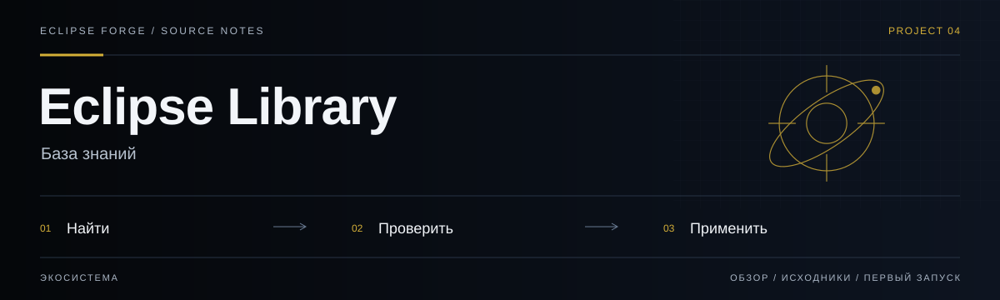
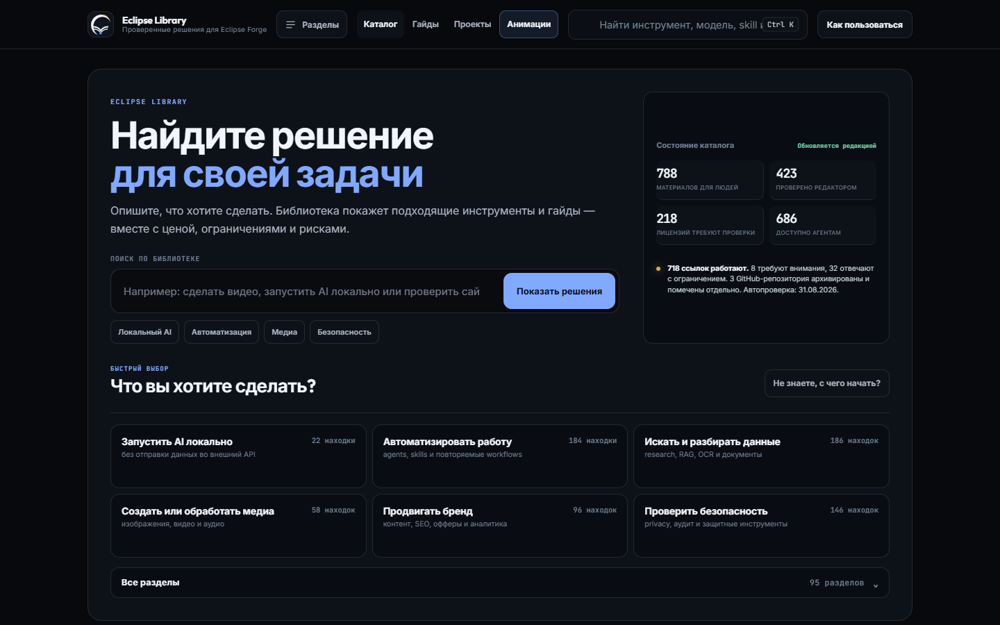
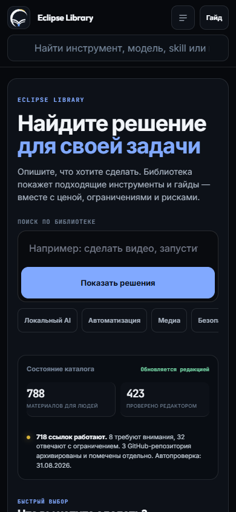

# Eclipse Library

<!-- project-links:start -->
[Открыть сайт](https://library.eclipse-forge.ru/) · [Документация](docs/repository-guide.md) · [Код](https://github.com/PavelHopson/eclipse-library/tree/master) · [История изменений](https://github.com/PavelHopson/eclipse-library/commits/master/)
<!-- project-links:end -->



**База знаний.** Кураторская библиотека инструментов, практических гайдов и решений с источниками и ограничениями применения.

## Практика и учебные игры

В разделе [«Практика»](https://library.eclipse-forge.ru/#learn) доступны задания с ответами, самопроверкой и локальным прогрессом. Прогресс курса можно скачать и восстановить в другом браузере.

Для практикумов по доступной форме и анализу поддержки можно указать свою цель и вручную выбрать направление. Цель сохраняется вместе с прогрессом; её изменение не удаляет ответы. Текстовый отчёт содержит цель, ответы, критерии и самооценку. Он подходит для обсуждения с преподавателем, но не подтверждает квалификацию. Для восстановления работы используйте JSON прогресса, а не текстовый отчёт.

Готовые курсы можно читать по модулям и урокам, отмечая прочитанное. Для импорта используется JSON `CourseContent` из Educator-AI: `title`, `summary`, `level`, `modules` с `lessons` (`heading`, `content`, необязательный `example`) и необязательными вопросами `quiz` (`question`, `answer`). Учебный образец — [course.json](web/learning-examples/course.json). Размер файла ограничен 256 КиБ; коллекция в браузере вмещает до пяти курсов без автоматического удаления старых. Скачанная JSON-копия содержит курс и прогресс для восстановления на другом устройстве. Для чтения вне библиотеки можно отдельно скопировать или скачать весь курс в Markdown, включая примеры и ответы на вопросы; прогресс в Markdown не переносится. Импорт проверяет формат, но не достоверность учебного текста; отметка «прочитано» не означает оценку знаний. Автоматической генерации или синхронизации с аккаунтом нет.

Учебные игры — викторина с разбором ответов и текстовый квест с выбором действий. Можно открыть готовый пример или импортировать JSON `GameContent` из Educator-AI: тип `QUIZ` либо `ESCAPE_ROOM`, до 128 КиБ. Образцы формата находятся в [web/learning-examples](web/learning-examples). Неподдерживаемые поля, внешние изображения и некорректные связи сцен отклоняются. Тексты импортированного материала остаются текстом, код из них не выполняется.

Игры работают без внешнего AI и ключей; импортированный файл не отправляется на сервер. До пяти игр с прохождением сохраняются в этом браузере: выбранные ответы, разбор, результат, сцена квеста и инвентарь доступны после перезагрузки. Разные версии игры хранятся отдельно; повторный импорт той же игры продолжает сохранённую попытку. Для переноса на другое устройство скачайте игру с прогрессом и импортируйте эту копию (до 160 КиБ). Автоматической синхронизации с аккаунтом нет. При ошибке сохранения скачайте копию до закрытия вкладки; очистка данных браузера удаляет локальные сохранения. Перезапуск и удаление требуют подтверждения.

Оценка нужна для самопроверки, не является сертификатом или защищённым экзаменом. Автор материала отвечает за его содержание; проверка JSON проверяет структуру, а не достоверность. Код адаптирован из Educator-AI с сохранением [лицензии MIT](web/licenses/educator-ai-MIT.txt).

<!-- eclipse-forge-projects:start -->
## Проекты Eclipse Forge

[Главная Eclipse Forge](https://eclipse-forge.ru/) · [Eclipse Library](https://library.eclipse-forge.ru/) · [Eclipse DnD Forge](https://dnd.eclipse-forge.ru/)

Исходный код: [Eclipse Forge Landing](https://github.com/PavelHopson/Eclipse-forge-website) · [Eclipse Chat](https://github.com/PavelHopson/eclipse-chat) · [Eclipse Connect](https://github.com/PavelHopson/eclipse-connect) · [Eclipse Library](https://github.com/PavelHopson/eclipse-library) · [Eclipse AI Hub](https://github.com/PavelHopson/eclipse-ai-hub) · [Eclipse Ultron / Sentinel](https://github.com/PavelHopson/eclipse-hopson-sentinel) · [Eclipse Webclaw](https://github.com/PavelHopson/Eclipse-webclaw) · [Eclipse DnD Forge](https://github.com/PavelHopson/eclipse-dnd-forge) · [Finflow](https://github.com/PavelHopson/finflow) · [Eclipse Media](https://github.com/PavelHopson/eclipse-media) · [Shotforge](https://github.com/PavelHopson/shotforge) · [Text2Image](https://github.com/PavelHopson/Text2Image) · [Educator AI](https://github.com/PavelHopson/Educator-AI) · [@pavelhopson/retry-http](https://github.com/PavelHopson/retry-http)
<!-- eclipse-forge-projects:end -->

<!-- repository-guide:start -->
[Интерфейс](#readme-interface) · [Первый запуск](#readme-start) · [Что внутри](#readme-map) · [Путеводитель](docs/repository-guide.md#start) · [Карта кода](docs/repository-guide.md#map) · [Проверки](docs/repository-guide.md#checks) · [Границы и права](docs/repository-guide.md#boundaries)

<a id="readme-interface"></a>

## Интерфейс



**Главная Library: поиск, направления и локальный индекс материалов.**

Локальный снимок от 8 сентября 2026: отдельный профиль браузера, без внешних API и пользовательских секретов. Это вид интерфейса, не подтверждение production-функций.

<details>
<summary><strong>Мобильный экран · 390 px</strong></summary>



</details>

[Открыть в полном размере](docs/assets/ui/overview.png) · [Данные снимка](docs/assets/ui/capture.json)

<a id="readme-map"></a>

## Проект за минуту

- **[Каталог](<catalog/resources.json>)** — Канонические записи, источники и редакционные статусы.
- **[Практические гайды](<guides>)** — Инструкции по применению материалов в проектах.
- **[Animation Lab](<web/animations.html>)** — Интерактивные примеры и визуальные эксперименты.

<a id="readme-start"></a>

## Начать локально

**Среда:** Python 3 для локального статического сервера. **Источник:** [web/index.html](<web/index.html>).

Из корня клонированного репозитория:

```bash
python -m http.server 8000 --bind 127.0.0.1 --directory web
```

Откройте http://127.0.0.1:8000. Сервер обслуживает только готовую папку web; публикации и перестроения каталога нет.

<details>
<summary><strong>Перед первым запуском и изменением кода</strong></summary>

- Команды сверены с исходниками 8 сентября 2026. Это инструкция, а не отметка об успешном запуске или текущем production.
- Установка зависимостей может обращаться в registry и выполнять lifecycle scripts. Используйте отдельную рабочую среду и демонстрационные данные.
- Карточка в библиотеке не означает одобрение установки. Лицензия, источник и допуск для агентов проверяются отдельно.
- [ROADMAP.md](<ROADMAP.md>)

</details>
<!-- repository-guide:end -->

## Текущее состояние

Текущие записи и редакционные статусы хранятся в [catalog/resources.json](catalog/resources.json), а пользовательский индекс — в [web/catalog-index.json](web/catalog-index.json). Счётчики не дублируются вручную в README: они меняются при редакторских обновлениях. Наличие локального индекса не подтверждает его публикацию.

## Как устроены данные

README больше не является базой данных и не разбирается в браузере.

| Слой | Назначение |
|---|---|
| [`catalog/resources.json`](catalog/resources.json) | Канонические structured records. Новые записи и редакторские правки вносятся сюда. |
| [`web/catalog-index.json`](web/catalog-index.json) | Production index schema v2: normalized license, evidence, `addedAt`, agent policy и счётчики. |
| [web/catalog-summary.json](web/catalog-summary.json) | Компактный initial payload для поиска, фильтров, карточек и Inspector без загрузки полного каталога. |
| [web/catalog-details/](web/catalog-details/) | 16 deterministic shards с полным анализом, evidence и ограничениями; загружается только при открытии записи. |
| [web/license-review-queue.json](web/license-review-queue.json) | Deterministic evidence queue для оставшихся ручных проверок: bucket, P1–P3, причина и следующий шаг без автоматического approval. |
| [`web/catalog-details.json`](web/catalog-details.json) | Исторический набор ручных editorial reviews; его содержимое уже мигрировано в canonical records. |
| [`web/github-metadata.json`](web/github-metadata.json) | Official GitHub state и license evidence для repository URL. |
| [`web/guides.json`](web/guides.json) | Manifest учебных материалов. |
| [`web/star-technology-registry.json`](web/star-technology-registry.json) | Read-only decision registry для Eclipse Market, Eclipse CRM и Eclipse AI; lifecycle хранится отдельно от runtime health. |
| [`web/registry.html`](web/registry.html) | Поиск, product filters, evidence, risks, approval policy и stable deep links для решений Eclipse. |
| [`web/catalog-card.js`](web/catalog-card.js), [`web/catalog-editorial.js`](web/catalog-editorial.js), [`web/catalog-progressive.js`](web/catalog-progressive.js) | UI-модули карточки, редакционной ленты и progressive DOM; первая страница ограничена 36 карточками. |
| [`web/catalog-inspector.js`](web/catalog-inspector.js), [`web/navigator.css`](web/navigator.css) | Безопасный evidence-first быстрый обзор и отдельный responsive visual layer Knowledge Navigator. |
| [`web/catalog-review.js`](web/catalog-review.js), [`web/review.css`](web/review.css) | Локальный editorial review: четыре обязательные проверки, явный итог, ограниченный draft и copy-ready JSON packet без изменения каталога. |
| [`web/catalog-search.js`](web/catalog-search.js) | Детерминированный RU/EN search planner: синонимы, короткий stopword-list и tolerance к одной опечатке без отправки запросов во внешний сервис. |
| [`web/api/v1/`](web/api/v1/) | Static JSON exports для внешних consumers и AI-агентов. |
| [`lists/catalog-legacy-2026-08-03.md`](lists/catalog-legacy-2026-08-03.md) | Read-only архив старого Markdown-каталога; application его не читает. |

## API и exports

Production endpoints:

- [Full catalog](https://library.eclipse-forge.ru/api/v1/catalog.json) — все записи для human-facing interfaces.
- [Agent-safe catalog](https://library.eclipse-forge.ru/api/v1/agents.json) — без grey и других fail-closed exclusions.
- [Eclipse CRM export](https://library.eclipse-forge.ru/api/v1/starcrm.json) — стабильный consumer contract без чтения README.
- [Eclipse AI export](https://library.eclipse-forge.ru/api/v1/starai.json) — стабильный consumer contract без чтения README.
- [Manifest](https://library.eclipse-forge.ru/api/v1/manifest.json) — версия каталога, счётчики и ссылки на endpoints.

Static exports предназначены для server-side или controlled consumers. Для browser-to-browser cross-origin чтения нужно отдельно подтвердить CORS configuration на production proxy.

### Редактор Library

Редакторская панель доступна по [`/editor.html`](web/editor.html). Она рассчитана на отдельный сервис [`editor-api/`](editor-api/): отдельный аккаунт, PostgreSQL и SSE-обновления. Статический сайт не хранит пароль, сессию или изменения в `localStorage`; продакшен-подключение API требует отдельного HTTPS reverse proxy и серверных секретов.

### Safety contract

- Каталог никогда не устанавливает инструмент сам.
- В agent exports у всех записей `actions.installFromCatalog` равно `false`.
- Grey resources остаются доступными для ручного исследования, но не рекомендуются агентами автоматически.
- External mutations, публикации, платежи и работа с production accounts требуют отдельного human approval.
- Кнопка «Проверить карточку» создаёт только локальный review-пакет: он не повышает `reviewStatus`, не меняет JSON и не является разрешением на merge или deploy.
- Наличие ссылки или GitHub license metadata не является security endorsement.

## Поля записи

Каждая production-запись содержит:

- стабильные `id`, `url`, `title`, `type`, `category` и `subcategory`;
- простое описание, use cases, платформы, стоимость и требования к аккаунту;
- `addedAt` отдельно от категории;
- `licenseInfo` с normalized label, SPDX, статусом проверки и evidence links;
- trust, risk, limitations, решение Eclipse и применимость к проектам;
- `agentEligibility` с причинами исключения и fail-closed install policy;
- ссылку на canonical source record.

## Как проверить карточку локально

1. Открыть «Полный анализ» или Inspector и нажать «Проверить карточку».
2. Подтвердить источник, условия, риски и практическую пользу, затем выбрать итог.
3. Добавить короткую заметку и скопировать packet или скачать его как JSON.
4. Для proposal запустить [локальный disposable preview](guides/editorial-review-preview.md) на полном SHA базового commit.
5. Прочитать semantic summary и полный `git diff`, запустить quality/security/responsive checks и отдельно записать approve/reject.

Draft хранится только в `localStorage` текущего браузера, ограничен 40 карточками и 1600 символами на заметку. Очистка browser data удаляет draft. Если Clipboard API недоступен, интерфейс показывает выделенный JSON для ручного копирования. Preview CLI принимает только завершённый v2 packet с итогом `approve`, меняет ровно одну уже существующую карточку и никогда не выполняет auto-apply, merge или deploy.

## Как добавить или обновить ресурс

1. Найти дубликат по canonical URL, GitHub repository и normalized title.
2. Проверить официальный источник, владельца, активность, лицензию, Terms, privacy и pricing.
3. Добавить или обновить запись в `catalog/resources.json`.
4. Не повышать `reviewStatus` до `verified` без ручной проверки и даты `verifiedAt`.
5. Для рискованных материалов использовать `type: grey`, `decision: no/reference` и конкретные ограничения.
6. Пересобрать derived data и exports.
7. Запустить validators, security pass и browser QA.

Команды:

```bash
node scripts/build-catalog-index.mjs
node scripts/build-catalog-runtime.mjs
node scripts/build-catalog-exports.mjs
node scripts/build-guides-manifest.mjs
node scripts/validate-catalog-index.mjs
node scripts/validate-catalog.mjs
node scripts/validate-star-technology-registry.mjs
node scripts/check-links.mjs
```

GitHub metadata с license evidence обновляется отдельно авторизованным maintainer:

```bash
GITHUB_TOKEN=... node scripts/refresh-github-metadata.mjs
```

## Проверки

Quality workflow проверяет:

- deterministic build canonical catalog и static exports;
- compact runtime summary, deterministic detail shards и lazy-loading client contract;
- duplicate URL, repository и title identities;
- normalized license/evidence schema;
- запрет grey resources в agent exports;
- запрет direct install;
- link-health, GitHub metadata, MCP audit и projects schemas;
- JavaScript syntax, progressive DOM budget в 36 карточек, mobile scroll guards и production smoke contract;
- review packet/patch policy и end-to-end detached worktree lifecycle без mutation/merge/deploy.

## Документация

- [ROADMAP](ROADMAP.md)
- [Editorial Review Preview](guides/editorial-review-preview.md)
- [Eclipse Growth OS](guides/eclipse-growth-os.md)
- [Creator Ops Stack](guides/creator-ops-stack.md)
- [Discovery, review и provenance radar](guides/august-2026-discovery-review-security-radar.md)
- [August 2026 research, privacy and tooling radar](guides/august-2026-research-privacy-tools-radar.md)
- [Razer AIKit и Diagram Design: проверка и план внедрения](guides/razer-aikit-diagram-design-review.md)
- [GitHub Spec Kit: Eclipse Spec Gate](guides/github-spec-kit-eclipse-gate.md)
- [ChatGPT Work + Codex operating model](guides/chatgpt-work-codex-operating-model.md)
- [August 2026 harness, media and code radar](guides/august-2026-harness-media-code-radar.md)
- [Eclipse Repository Architecture Map Prompt](guides/repository-architecture-map.md)
- [Eclipse Forge Codex session tree](guides/eclipse-session-tree.md)
- [August 2026 skills, Voice OS and Growth rollout](guides/august-2026-skills-voice-growth-rollout.md)
- [Seven AI service offers: проверка и rollout Eclipse Forge](guides/seven-ai-service-offers-eclipse-forge.md)
- [Eclipse Automation Playbook: 45 bounded workflows](guides/eclipse-automation-playbook-45.md)
- [Community Agent Prompt Library: safe rollout](guides/community-agent-prompt-library-review-2026-08-22.md)
- [Frontend motion references: evidence, accessibility and performance review](guides/frontend-motion-reference-review-2026-08-20.md)
- [Eclipse Diagram Contract: первый static data-flow pilot](web/diagrams/catalog-data-flow.html)
- [Eclipse AI Hub: model provider boundary](web/diagrams/ai-hub-provider-boundary.html)
- [Hopson Sentinel: capability и approval boundary](web/diagrams/sentinel-capability-boundary.html)
- [Eclipse DnD Forge: безопасный Azgaar import](web/diagrams/dnd-azgaar-import-boundary.html)
- [Shotforge, Eclipse Media и Text2Image: storyboard handoff](web/diagrams/media-storyboard-handoff.html)
- [AI Landing Sprint](guides/ai-landing-sprint.md)
- [Operational agent stack](guides/august-2026-operational-agent-stack.md)
- [Agent Reach security review](guides/agent-reach-security-review-2026-07-31.md)
- [Azgaar DnD map workflow](guides/azgaar-dnd-map-workflow.md)
- [MCP runtime audit](guides/mcp-runtime-audit.md)
- [Eclipse Technology Registry](guides/star-technology-registry.md)

<a id="license"></a>

## Лицензия

Редакционные материалы Eclipse Library принадлежат Eclipse Forge. Каждый внешний ресурс, repository, model, dataset, prompt и service сохраняет собственные license и Terms; точный статус указан в соответствующей карточке.

## Локальная проверка интерфейса и редактора

Зависимости проверок хранятся в игнорируемой `.artifacts/`, production не используется:

```powershell
npm install --prefix .artifacts/visual-qa/tools --no-save playwright@1.52.0 pg@8.13.1
.artifacts/visual-qa/tools/node_modules/.bin/playwright install chromium
node scripts/library-visual-qa.cjs
node scripts/library-editor-qa.cjs
```

Первый сценарий проверяет основные страницы на ширинах 320/390/768/1024/1440, сохраняет скриншоты и проверяет переполнение, пересечение элементов шапки, ошибки JS и безопасный вывод поискового запроса. Отсутствие API фиксируется отдельно; этот прогон не подтверждает работу редактора. Результаты: `.artifacts/visual-qa/latest/report.json`.

Второй сценарий для Windows использует PostgreSQL из `C:/postgres/bin` (можно задать `QA_PG_BIN`). Создаёт отдельный временный кластер с паролем и случайным локальным портом, применяет настоящую схему, запускает API и браузер. Проверяет неверный пароль, вход, drag-and-drop, сохранение после перезагрузки, публикацию, полный промпт, просмотр изображения внутри страницы, мобильную вёрстку и выход. После завершения останавливает процессы и удаляет тестовую базу и изображения. Отчёт и снимки: `.artifacts/visual-qa/editor/`.

Это локальные проверки Chromium, а не подтверждение production, Safari или Firefox. Скриншоты требуют визуального просмотра; автоматические геометрические проверки не оценивают качество дизайна целиком.
