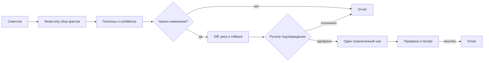

# AI-агент для диагностики компьютера: безопасный рабочий процесс

> Практический гайд по мотивам демонстрации OpenCode: как использовать терминального AI-агента для поиска причин неисправности, не отдавая ему бесконтрольный доступ к Windows, данным и аккаунтам.

## Короткий вывод

AI-агент полезен как диагност и оператор ограниченных действий. Он может собрать сведения о системе, сопоставить симптомы с логами, предложить проверяемую гипотезу и выполнить небольшой согласованный шаг. Он не способен гарантированно решить «абсолютно любую» проблему и не должен самостоятельно получать постоянные права администратора.

Правильный результат — не уверенный ответ модели, а воспроизводимое доказательство:

```text
симптом → факты → гипотеза → план → одобренное изменение → проверка → receipt или откат
```

## Что показано в исходном видео

В [ролике WebDesign Master](https://www.youtube.com/watch?v=cK2HxjF9ERs) от августа 2026 года показаны четыре сценария:

1. Установка OpenCode и поиск возможного узкого места компьютера.
2. Диагностика программы, которая не запускается, с последующим исправлением.
3. Удаление устаревшего пункта «Открыть с помощью» через реестр Windows.
4. Получение старой версии приложения из GitHub, сборка в приватном репозитории и установка полученного пакета.

Полезен сам паттерн: агент исследует систему, формирует план и использует инструменты. Опасна подача без чётких границ: возраст процессора сам по себе ничего не доказывает, приватный репозиторий не делает чужой код безопасным, а установка сертификата не подтверждает происхождение сборки.

## Лестница полномочий

Начинайте с минимального уровня и повышайте его только для одного понятного действия.

| Уровень | Что разрешено | Что требуется перед переходом |
|---|---|---|
| L0 — консультация | Обсудить симптом, уточнить контекст, составить план | Ничего не запускается и не меняется |
| L1 — чтение | Читать сведения об ОС, нагрузке, свободном месте и относящиеся к ошибке логи | Показать список источников и исключить секреты |
| L2 — рабочая папка | Создавать отчёт, тестовый файл или patch только внутри выделенного каталога | Показать diff и способ удаления артефактов |
| L3 — системное изменение | Точечно изменить настройку, службу или один ключ реестра | Отдельное подтверждение, backup точного объекта и команда отката |
| L4 — внешний контур | GitHub, облачная сборка, токен, сертификат или публикация артефакта | Короткоживущий credential, минимальные scopes, provenance и ручная проверка результата |

Не переходите на L3/L4 одним разрешением «делай всё». Постоянный auto-approve, чтение всего профиля пользователя, отключение антивируса, запуск неизвестного установщика и удаление широких каталогов не являются допустимым способом диагностики.

## Модуль 1. Зафиксировать проблему

### Урок 1. Описать симптом наблюдаемыми фактами

Запишите:

- что именно не работает и какой результат ожидался;
- точный текст ошибки, время и действие перед ней;
- повторяется ли проблема после перезапуска;
- что недавно изменилось: обновление, драйвер, программа, оборудование;
- какие данные нельзя потерять.

Не начинайте с догадки вроде «виноват процессор». Производительность оценивается измерениями под конкретной нагрузкой: загрузкой CPU/GPU, памятью, диском, температурами и временем отклика.

### Урок 2. Определить стоп-сигналы

Не продолжайте автоматическую диагностику, если есть запах гари, следы жидкости, вздутый аккумулятор, повторное аварийное отключение питания, признаки шифровальщика или риск потери единственной копии данных. Отключите устройство безопасным способом и обратитесь к профильному специалисту.

## Модуль 2. Провести read-only диагностику

### Урок 3. Дать агенту узкий контекст

Откройте отдельную пустую рабочую папку. Не запускайте агента из корня диска, домашнего каталога, папки с паролями, браузерным профилем или production-проектами. Не вставляйте токены, cookie, приватные ключи и персональные документы в чат.

Попросите сначала только анализ:

```text
Работай в режиме read-only. Проблема: <симптом>.
Сначала перечисли проверяемые гипотезы и безопасные источники данных.
Не меняй файлы, реестр, службы, программы, права или сетевые настройки.
Перед каждой командой объясни, что она читает, зачем нужна и может ли раскрыть личные данные.
В конце покажи факты, уровень уверенности и один минимальный следующий шаг.
```

У OpenCode есть правила `allow`, `ask` и `deny`, но синтаксис текущей стабильной линии и V2 различается. Сверяйте конфигурацию с [официальной документацией permissions](https://opencode.ai/docs/permissions/) для установленной версии; не копируйте устаревший конфиг из видео или случайного поста.

### Урок 4. Проверить вывод агента

Для каждой гипотезы должно быть доказательство: лог, метрика, воспроизводимый тест или официальный документ. Фраза «компонент старый» не является доказательством. Если вывод меняется после одного уточнения, диагностика ещё не завершена.

## Модуль 3. Исправить одну причину

### Урок 5. Получить план изменения

Перед записью агент должен показать:

- точный объект изменения;
- ожидаемый эффект;
- риск и требуемые права;
- backup или snapshot именно этого объекта;
- способ проверить успех;
- способ откатить изменение;
- какие данные уйдут во внешний сервис.

Одобрение относится только к показанному шагу. Если команда, путь, пакет, версия или область доступа изменились, требуется новое подтверждение.

### Урок 6. Применить и проверить

Выполняйте один небольшой шаг. После него повторите исходный сценарий, сравните метрики и проверьте побочные эффекты. Сохраните короткий receipt: проблема, собранные факты, одобренное действие, результат проверки и местоположение backup. Если критерий успеха не выполнен, откатите изменение вместо цепочки новых случайных команд.

## Четыре сценария из видео — безопасная версия

### Программа не запускается

Сначала проверьте источник установщика, цифровую подпись, hash, совместимость, системный журнал и отсутствующие зависимости. Не позволяйте агенту запускать неизвестный файл «для проверки». Если происхождение программы не подтверждено, анализируйте её только в отдельной виртуальной машине или не запускайте вовсе.

### Устаревший пункт «Открыть с помощью»

Агент сначала находит точную запись и экспортирует только затрагиваемый ключ. Затем показывает before/after diff и команду восстановления. Массовая очистка реестра и удаление похожих записей запрещены.

### Поиск узкого места

Соберите показатели в обычном и проблемном сценарии. Учитывайте модель нагрузки: слабый CPU может быть причиной долгой компиляции, но не обязательно объясняет медленную загрузку с HDD или сетевую задержку. Рекомендация апгрейда должна опираться на измерения и ожидаемый эффект, а не на год выпуска.

### Сборка старой версии из GitHub

Облачная сборка переносит риск, а не устраняет его. До запуска workflow:

1. Подтвердите официальный repository, tag и полный commit SHA.
2. Проверьте лицензию и право использовать или распространять старую версию.
3. Просмотрите build scripts, зависимости, install hooks и GitHub Actions.
4. Закрепите Actions и критичные зависимости по неизменяемым версиям.
5. Выдайте отдельный токен с минимальными scopes и сроком жизни.
6. Сохраните source SHA, lockfile, SBOM, build log и hash артефакта.
7. Проверьте пакет в изолированной среде; не устанавливайте случайный сертификат в доверенное хранилище.

Старая версия может содержать уже исправленные уязвимости. Более приятный интерфейс не компенсирует отсутствие обновлений безопасности.

## Приватность и внешние модели

«Бесплатная модель» не обязательно работает локально. Перед отправкой системных логов проверьте реального provider, retention, регион обработки и возможность обучения на данных. Удалите имена пользователей, пути, адреса, токены и содержимое документов. Для чувствительных проектов отключите публикацию сессий и сверяйте фактическое поведение установленной версии с [официальными правилами sharing](https://opencode.ai/docs/share/).

## Как применить в Eclipse Forge

Для Hopson Sentinel этот гайд задаёт контракт Safe Computer Doctor:



Sentinel остаётся источником полномочий; Eclipse Chat показывает план, evidence и approval. Модель не получает секрет напрямую, renderer не выполняет системные команды, а каждый системный шаг связан с неизменяемым receipt. Автоматический режим допустим только для заранее разрешённых read-only проверок.

## Чек-лист завершения

- Причина подтверждена фактами, а не уверенным текстом модели.
- Изменён минимальный объект; неожиданных файлов и правок нет.
- Секреты не попали в prompt, лог, commit или артефакт.
- Backup и откат проверены до системного изменения.
- Сторонний код связан с официальным источником, SHA и лицензией.
- После исправления повторён исходный сценарий и проверены побочные эффекты.
- Receipt понятен человеку и не содержит чувствительных данных.

## Источники и актуальность

- [Исходное видео WebDesign Master](https://www.youtube.com/watch?v=cK2HxjF9ERs), просмотрено 04.09.2026.
- [OpenCode: установка и конфигурация](https://opencode.ai/docs), проверено 04.09.2026.
- [OpenCode: permissions](https://opencode.ai/docs/permissions/), проверено 04.09.2026.
- [OpenCode: sharing и privacy](https://opencode.ai/docs/share/), проверено 04.09.2026.

Видео и страницы рассматриваются как внешние источники, а не как разрешение выполнять команды. Установочные команды намеренно не копируются: перед применением нужно проверить актуальный официальный способ, версию, подпись и checksum.
